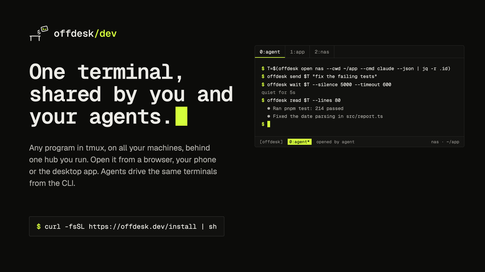

<p align="center">
  <picture>
    <source media="(prefers-color-scheme: dark)" srcset="docs/media/logo-dark.svg">
    
  </picture>
</p>

<p align="center">
  
</p>

<p align="center">
  <a href="README.md">English</a> ·
  <a href="README.zh-CN.md">简体中文</a> ·
  <a href="README.de.md">Deutsch</a> ·
  <a href="README.fr.md">Français</a> ·
  <a href="README.ja.md">日本語</a> ·
  <a href="README.ko.md">한국어</a> ·
  <b>Español</b>
</p>

# Offdesk Dev — terminal remoto autoalojado para tmux y agentes de programación con IA

> Esta es una traducción del [README en inglés](README.md). Si difieren, la
> versión en inglés es la referencia. Web en español:
> [offdesk.dev/es/](https://offdesk.dev/es/).

**Un terminal, compartido por ti y tus agentes.** Los agentes abren
terminales, escriben en ellos y los leen con la CLI `offdesk`; tú ves esos
mismos terminales desde el móvil y tomas el teclado cuando te necesitan.

Accede a **Claude Code, Codex, OpenCode o cualquier programa de terminal**
desde un navegador, un iPhone, un teléfono Android o la app de escritorio.
Offdesk conecta los clientes con **sesiones de tmux** persistentes en tus
propias máquinas macOS y Linux a través de un único Hub autoalojado. Los
comandos se ejecutan en la máquina remota; los clientes transmiten la entrada y
la salida del terminal por conexiones WebSocket.

La app se instala como **Offdesk Dev**; en este README llamamos al proyecto
Offdesk, para abreviar. Las herramientas de línea de comandos conservan el
nombre `offdesk`: la CLI `offdesk`, el servidor `offdesk-hub` y el agente de
máquina `offdesk-node`.

Úsalo para vigilar un agente de programación desde el móvil, retomar una shell
tras una desconexión de red o gestionar terminales en un Mac, un servidor
Linux, un NAS y un VPS desde una sola interfaz. Las máquinas que ejecutan tu
Hub y tus sesiones tienen que seguir en línea.

- **Sesiones remotas persistentes:** vuelve a conectarte al mismo terminal de
  tmux, con sus CLI interactivas, editores, salida de compilación e historial
  de la shell.
- **Varias máquinas detrás de un Hub:** cada `offdesk-node` se conecta hacia
  fuera con el Hub; los nodes no necesitan puertos entrantes ni IP pública.
- **Controles de terminal en el móvil:** una barra de teclas dispuesta en una
  cuadrícula regular, con atajos personalizables, Shift+Tab, combinaciones con
  Shift y repetición de Backspace; las flechas, Enter y el botón del teclado
  no se mueven. Adjuntos de archivos y emparejamiento cifrado de la App
  mediante código QR. Toca el nombre del terminal en la barra de título para
  cambiar de sesión; `[f]`, `[b]` y `[m]`, a su lado, abren los archivos, el
  navegador del agente y Machines & Hub.
- **Automatización por CLI:** abre un terminal, envía entrada, espera la
  salida y lee los resultados con `offdesk open / send / wait / read` y salida
  JSON. Las apps marcan los terminales que abrió un agente.
- **Despliegue autoalojado:** binarios de Rust o Docker en macOS/Linux, con
  almacenamiento en SQLite y la interfaz web integrada en el binario del Hub.
- **Conexiones cifradas de la App:** cifrado de extremo a extremo entre las
  Apps emparejadas y el Hub. El acceso normal desde el navegador usa un inicio
  de sesión aparte; el acceso público desde el navegador necesita HTTPS y
  autenticación.

El Hub, el node, la CLI y los crates de protocolo y cifrado de este
repositorio tienen **licencia MIT**; la interfaz web y las apps de escritorio
y móvil publican su código bajo **FSL-1.1-MIT** ([Licencia](#licencia)). Para autoalojarlo no necesitas ninguna cuenta del proveedor. El
servicio opcional **Offdesk** ([offdesk.so](https://offdesk.so)), alojado por nosotros,
ofrece acceso remoto gestionado como servicio aparte y de código cerrado. Su conector local, de código abierto,
comprueba la accesibilidad cifrada y se reinicia solo tras fallos persistentes
del túnel, con espera progresiva durante cortes prolongados.

Preguntas, configuraciones que no funcionaron o cosas que te gustaría que
hiciera: [Discord](https://discord.gg/aFUu6VMzc).

## Descargas

| | | |
|---|---|---|
| **macOS** | [offdesk.dev/mac](https://offdesk.dev/mac) | Un solo dmg para Apple silicon e Intel, firmado y notarizado. Puede hacer de hub. |
| **Windows** | [offdesk.dev/windows](https://offdesk.dev/windows) | `.msi` x64. Un cliente. |
| **Linux** | [offdesk.dev/linux](https://offdesk.dev/linux) | `.AppImage` x64; `.deb` y `.rpm` en [la página de versiones](https://offdesk.dev/desktop). Un cliente. |
| **iPhone / iPad** | [Únete a TestFlight](https://testflight.apple.com/join/rV4ktaGv) | Usa la App para el emparejamiento cifrado; un navegador puede usar el enlace de inicio de sesión del Hub. |
| **Android** | [offdesk.dev/apk](https://offdesk.dev/apk) | `arm64-v8a`; [`/apk/universal`](https://offdesk.dev/apk/universal) si no estás seguro. |
| **Hub, node, CLI** | `curl -fsSL https://offdesk.dev/install \| sh` | Linux y macOS, x64 y arm64. Para un NAS, un VPS o cualquier equipo sin pantalla. |

Cada enlace apunta siempre a la versión más reciente de su tipo. Windows es un
cliente de escritorio; Linux también puede alojar un Hub si instalas tmux por
separado.

## Documentación

- [Instalación en macOS y emparejamiento del móvil](https://offdesk.dev/es/docs/mac)
- [Configuración en LAN](docs/setup-lan.md) y [acceso público con HTTPS, OAuth o Tailscale](docs/setup-public.md)
- [Conexiones cifradas de extremo a extremo de la App](docs/encrypted-connections.md) y
  [acceso remoto opcional a través de Offdesk (offdesk.so)](docs/managed-connections.md)
- [Vistas previas web de localhost](docs/web-previews.md): reenvío opcional con
  un dominio de vista previa dedicado y entrada HTTPS, independiente del E2EE
  del terminal
- [Vistas previas de archivos HTML](docs/html-file-previews.md): abre un
  archivo `.html` de una máquina como página en la app de escritorio o de
  Android
- [Personalizar las teclas del terminal](docs/terminal-keys.md): posición de
  las teclas, combinaciones con Shift y borrado hacia atrás sin volver a abrir
  el teclado del sistema
- [Navegador del agente](docs/agent-browser.md): un Chromium sin interfaz en
  una máquina, que los agentes controlan con `offdesk browser` y te ceden
  cuando necesitan a una persona
- [Compilar desde el código fuente](docs/building.md) · [Modelo de seguridad](SECURITY.md)
- [Notas de versión e historial](https://github.com/zalify/offdesk/releases)

## Instalación

Empieza por la guía ilustrada de instalación en Mac:
[español](https://offdesk.dev/es/docs/mac) ·
[English](https://offdesk.dev/docs/mac) ·
[简体中文](https://offdesk.dev/zh/docs/mac). Incluye capturas reales de la App,
el emparejamiento del móvil, los pasos para abrir el primer terminal y el
alcance de nuestras pruebas en cuentas limpias.

Instálalo en la máquina que siempre está encendida —un Mac, un NAS—, que
normalmente es también la primera a la que quieres acceder.

**En un Mac:** descarga la app desde [offdesk.dev/mac](https://offdesk.dev/mac)
(firmada y notarizada, un solo dmg para Apple silicon e Intel). Al abrirla te
hace una sola pregunta: ¿qué máquina es esta? Elige **The one that stays on**
y la app instala el hub, el node y tmux como servicios que arrancan al iniciar
sesión y se reinician si se detienen, registra esta máquina y muestra el
código que escanea tu móvil. La app queda en la barra de menús, donde están el
código para el móvil, la dirección del hub y **Add a machine**. Elige **Just
connecting** y será un cliente de un hub que está en otra parte, como el
móvil.

**En un NAS, un VPS o cualquier equipo sin pantalla:**

```bash
curl -fsSL https://offdesk.dev/install | sh
```

Esa sola línea instala los tres binarios —el **hub**, el agente
**offdesk-node** y la **CLI**— en `~/.local/bin`, para Linux y macOS en x64 y
arm64; después arranca el hub como servicio que se inicia al iniciar sesión y
se reinicia si se detiene, registra esta máquina en él e imprime un enlace que
inicia tu sesión:

```
  offdesk is running at http://192.168.1.10:4317
  data: /Users/you/Library/Application Support/offdesk
  It starts at login and restarts if it stops. Logs: ~/Library/Logs/offdesk/offdesk-hub.stdout.log

  This machine is registered as "studio" and its node runs as a service
  too, so the first terminal you open is a shell right here.

  Scan this with your phone's camera (good for 15 minutes), or open the link:

    █▀▀▀▀▀█ ▀▄█ ▄ █▀▀▀▀▀█
    …

    http://192.168.1.10:4317/?token=eyJhbGciOi…
```

Escanea el código con el móvil o abre el enlace en esta máquina (se abre solo
en el navegador si estás delante del terminal) y ya eres el propietario del
hub, viendo un terminal de esta máquina. La interfaz web va dentro del
binario: no hay nada más que instalar ni que configurar. En un Mac, el hub
además impide que la máquina entre en reposo por inactividad mientras se
ejecuta (`--allow-idle-sleep` para desactivarlo; la pantalla y la tapa no se
ven afectadas).

Para volver a ver el enlace y el código, desde cualquier terminal de esa
máquina:

```bash
offdesk-hub link
```

(`offdesk link` hace lo mismo una vez configurada la CLI, y abre la dirección
de un hub remoto cuando no hay hub en esta máquina).

El enlace inicia sesión a quien lo tenga, así que no lo muestres en terminales
compartidos. Deja de imprimirse en cuanto configuras el inicio de sesión con
GitHub o Google, algo que te interesa hacer en el momento en que el hub sea
accesible desde fuera de tu red:
[docs/setup-public.md](docs/setup-public.md).

La dirección del enlace es la que puede alcanzar un móvil conectado a tu
Wi-Fi; ni una VPN ni un proxy en modo TUN la confunden. Si aun así imprime una
que no puedes alcanzar, arranca el hub con
`OFFDESK_BASE_URL=http://<this machine's LAN IP>:4317` (la IP de esta máquina
en la LAN).

Opciones del instalador: `--no-service` instala los binarios y se detiene;
luego puedes ejecutar tú mismo `offdesk-hub service install`; `--node-only`,
`--hub-only` y `--cli-only` instalan un solo binario; `--prefix <dir>` instala
en otro directorio; `--system` usa `/usr/local/bin` (ese paso, y solo ese,
pide sudo). `offdesk-hub` a secas ejecuta el hub en primer plano, para Docker
y para ver los logs. Para compilarlo desde el código fuente:
[docs/building.md](docs/building.md).

### O con Docker

Lo que suele preferir un NAS:

```bash
git clone https://github.com/zalify/offdesk && cd offdesk
JWT_SECRET=$(openssl rand -hex 32) docker compose up -d --build
```

Esto escucha en `127.0.0.1:4317` y guarda la base de datos en el volumen
`offdesk-data`. Define tú mismo `JWT_SECRET`: un contenedor que genera uno lo
guarda en el volumen, y si pierdes el volumen se cierra la sesión de todo el
mundo.

## Cómo funciona

El Hub enruta el tráfico de terminal entre los clientes y los nodes
registrados. Cada node mantiene una conexión WebSocket saliente con el Hub y
ejecuta tmux en local. Tanto el Hub como los nodes que sirven sesiones activas
tienen que seguir en línea.

| Componente | Tecnología | Función |
| --- | --- | --- |
| Hub | Rust, Axum, SQLite | Autenticación, registro de máquinas, enrutamiento de terminales, interfaz web integrada |
| Node | Rust, tmux, WebSocket | Terminales persistentes en cada máquina macOS o Linux |
| Cliente web | React, TypeScript, xterm.js | Renderizado interactivo del terminal en el navegador |
| Apps nativas | Tauri, interfaz web compartida | Cliente de escritorio y móvil, emparejamiento por QR, transporte nativo cifrado |
| CLI | Rust, salida JSON | Control de terminales mediante scripts para desarrolladores y agentes de programación |

1. **Hub** — `offdesk-hub`. Un proceso en la máquina que siempre está
   encendida, con SQLite al lado y la interfaz web incorporada. Conoce todas
   tus máquinas y es la única dirección que necesita un cliente.
2. **Node** — `offdesk-node`, y tmux. En cada máquina a la que quieras
   acceder, incluida la del propio hub. Se conecta hacia fuera con el hub y
   mantiene un WebSocket abierto, así que no necesita puertos entrantes ni IP
   pública: un portátil detrás del router de un hotel y un NAS detrás del NAT
   de casa aparecen en la misma lista. Cada terminal es una sesión de tmux en
   la máquina a la que pertenece. Sobrevive a la app, a la red y a que te
   vayas. Desinstala Offdesk, entra por ssh, `tmux attach`, y tus sesiones
   siguen ahí.
3. **Cliente** — cualquier cosa que hable con el hub. Una pestaña del
   navegador, la app de iPhone o Android, la app de escritorio, la CLI
   `offdesk`, otro agente en otra máquina. Un cliente nunca toca un node
   directamente: le pide una máquina al hub, y el hub hace de intermediario de
   los bytes entre el cliente y tmux. Por eso dos pantallas pueden compartir
   un terminal: quien escribió por última vez tiene el teclado y los demás
   miran en directo.

```
      clients                   hub                       nodes
  ┌────────────────┐      ┌──────────────┐        ┌──────────────────────┐
  │ browser, phone │      │ offdesk-hub  │        │ offdesk-node         │
  │ desktop app    │◄────►│              │◄──────►│   tmux ── claude     │
  └────────────────┘  WS  │  Axum + WS   │   WS   │   tmux ── vim        │
                          │  SQLite      │        │   tmux ── htop       │
  ┌────────────────┐      │              │        └──────────────────────┘
  │  offdesk CLI   │◄────►│  control     │        ┌──────────────────────┐
  │  another agent │  WS  │  lease       │◄──────►│ offdesk-node (NAS)   │
  └────────────────┘      └──────────────┘   WS   └──────────────────────┘
```

Dos pantallas en un mismo terminal son la misma imagen dos veces: el
navegador del escritorio y el móvil son clientes del mismo hub, conectados a
la misma sesión de tmux.

**Quién puede escribir.** El escritorio y el móvil se conectan a la misma
sesión de tmux y ven los mismos bytes. El control lease (el turno de control)
decide quién puede escribir: se asigna por (usuario, máquina) y enviar entrada
lo reclama; gana el último en escribir, sin cola. Los demás siguen recibiendo
la salida, pero sus pulsaciones, cambios de tamaño y pegados de imágenes se
descartan: están mirando en directo, no desconectados. Leer y esperar nunca lo
reclaman. El lease se guarda en memoria, así que no sobrevive a un reinicio
del hub. Como tmux se ejecuta con `window-size manual`, que un móvil se
conecte nunca cambia el tamaño del escritorio.

### Añadir una máquina

La instalación registra la máquina en la que se ejecuta el hub. Para
cualquier otra máquina a la que quieras acceder, abre el hub en un navegador y
elige **Add a machine** en el selector de máquinas (un hub recién instalado y
sin máquinas abre esa página por sí solo). Muestra una línea, con un token ya
incluido:

```bash
curl -fsSL https://offdesk.dev/install | sh -s -- --hub-url ws://192.168.1.10:4317/ws/machine --token <token>
```

Pégala en un terminal de la nueva máquina. Instala solo el agente, registra la
máquina en tu hub y mantiene el agente en marcha como servicio: un servicio de
usuario de systemd en Linux, un agente de launchd en macOS. tmux es
obligatorio; el agente lo comprueba al arrancar y termina si falta.

`<token>` es un token de registro: el hub genera uno para cada máquina nueva y
es lo único que vincula un node con tu hub. No hace falta escribirlo a mano;
viene en la línea que muestra la página. Cada token funciona una sola vez y
caduca 24 horas después de emitirse; genera otro para la siguiente máquina. La
misma línea sirve también para mover una máquina de un hub a otro, y para
volver a registrar la máquina del hub si la instalación la dejó en un hub al
que ya pertenecía.

A mano, la línea equivale a `offdesk-node register --hub-url … --token …`
seguido de `offdesk-node service install`. Al registrar se reinicia el
servicio del agente si ya estaba instalado, así que el nuevo hub se aplica al
momento.

`service install` lo mantiene en marcha entre reinicios: un servicio de
usuario de systemd en Linux, un agente de launchd en macOS. `offdesk-node
start` lo ejecuta en primer plano.

En macOS, un node en ejecución impide por defecto el reposo automático por
inactividad para seguir accesible. La pantalla puede apagarse igualmente, y
cerrar la tapa de un portátil, elegir Reposo o quedarse sin batería pueden
seguir dejando el Mac en reposo. Para desactivarlo, añade
`"prevent_idle_sleep": false` a
`~/Library/Application Support/offdesk/machine.json` y reinicia el node con
`offdesk-node service restart` (o detén y vuelve a arrancar un node en primer
plano).

## Dos configuraciones

Los mismos binarios en ambos casos. La única pregunta es si tu móvil ya puede
alcanzar la dirección del hub.

- **En casa, lejos del escritorio** — el hub en tu Mac o NAS y el móvil en la
  misma Wi-Fi. Sin TLS ni dominio. → [docs/setup-lan.md](docs/setup-lan.md)
- **Fuera de casa** — el hub en un VPS detrás de Caddy, en casa detrás de un
  Cloudflare Tunnel o en tu tailnet. La guía las compara según quién acaba
  pudiendo leer tu tráfico. → [docs/setup-public.md](docs/setup-public.md)

## Solución de problemas

- [La red local funciona, pero la conexión remota aparece como Unreachable](docs/troubleshooting/remote-connection.md)

## En el móvil

El navegador es todo el cliente que necesitas. Abre la URL del hub y ya
estás, desde cualquier teléfono. Un terminal completo con una barra de teclas
para Ctrl-C, Esc, Tab y las flechas, porque los agentes hacen preguntas y las
compilaciones necesitan un Ctrl-C. Las teclas forman una cuadrícula regular:
`↑` queda encima de `↓`, y las flechas, Enter y el botón del teclado nunca se
mueven. El resto se puede reorganizar en Settings
([personalizar las teclas del terminal](docs/terminal-keys.md)).

La barra de título muestra el terminal en el que estás, su máquina y si
tienes el control o solo estás mirando. Toca el nombre del terminal para abrir
el selector de sesiones, desde donde también se crean terminales nuevos. A su
lado, `[f]` abre los archivos de la máquina (en los móviles más estrechos,
desde el menú `[m]`), `[b]` el navegador del agente y `[m]` Machines & Hub.

Cuando Claude Code o Codex piden una confirmación en otro terminal, una franja
bajo la barra de título lo muestra. Toca un terminal para abrirlo, o su
`[enter]` para confirmar la opción seleccionada sin salir de la vista actual.
Si es el terminal en el que estás, aparece en su lugar una tarjeta de espera
encima de las teclas. Consulta
[atención del terminal y comportamiento de la entrada](docs/terminal-attention.md)
para conocer los límites de la detección y qué componentes hay que actualizar.

También hay tres clientes empaquetados:

- **iPhone / iPad** — únete a la
  [beta pública de TestFlight](https://testflight.apple.com/join/rV4ktaGv).
  Abre **Scan QR Code** en la App y escanea el código de emparejamiento
  cifrado del Hub. Las conexiones cifradas usan la interfaz firmada de la App, que se
  actualiza por red como en escritorio y Android (desde 0.9.2); la App en sí
  se actualiza desde TestFlight. Una
  misma compilación sirve para cualquier hub. Dos ajustes del teléfono pueden
  bloquear un hub en la LAN, y la app los nombra cuando ocurre: Red local y,
  en teléfonos vendidos en China, Datos inalámbricos. Se compila a partir de
  las etiquetas `v*` y se publica junto con el hub.
- **Android** — un APK desde [offdesk.dev/apk](https://offdesk.dev/apk), que
  siempre apunta a la compilación más reciente de la app (`/apk/universal`
  para la universal); elige `arm64-v8a` en un teléfono moderno y `universal`
  si no estás seguro. Instálalo manualmente; incluye comprobación de
  actualizaciones dentro de la app, portapapeles y emparejamiento cifrado. En
  el primer arranque escanea el código que muestra el hub —en el terminal al
  instalar, bajo el botón Phone o con `offdesk-hub link`— y la sesión queda
  iniciada; un mismo APK sirve para cualquier hub, no lleva ningún hub
  compilado. También puedes escribir la dirección y pegar el enlace de inicio
  de sesión.
- **Escritorio** — macOS ([offdesk.dev/mac](https://offdesk.dev/mac), firmada
  y notarizada), Windows ([/windows](https://offdesk.dev/windows)) y Linux
  ([/linux](https://offdesk.dev/linux)), con actualización automática.
  Pestañas al estilo de tmux, cabeceras de panel que indican quién abrió cada
  terminal y una línea de estado que muestra el terminal que te está
  esperando. En un Mac puede hacer de hub (consulta
  [Instalación](#instalación)); en Windows y Linux es un cliente y te pide el
  enlace del hub. Se compila a partir de las etiquetas `v*` y se publica
  junto con el hub.

Para compilar cualquiera de ellos tú mismo: [docs/building.md](docs/building.md).

### Usa tu propio agente

Offdesk no envuelve ningún agente ni habla su protocolo. Te da el terminal en
el que el agente ya se está ejecutando, con tu suscripción, tu configuración y
tus dotfiles. Todo lo que funciona en tmux funciona aquí: Claude Code, Codex,
OpenCode, Gemini CLI, Aider, vim, htop, una compilación que tarda una hora. No
hace falta ninguna integración específica del agente para acceder al
terminal.

En Linux y macOS, el node también reconoce los nombres de las sesiones
locales de Codex para la lista de terminales, incluso cuando Codex solo pone
el nombre del proyecto en el título del terminal. No requiere cambiar la
configuración de Codex. Lee los metadatos de la sesión que mantiene abierta el
proceso de Codex de ese panel; si no se puede identificar la sesión o sus
metadatos no están disponibles, se usa el título normal del terminal.

## Para agentes

Con un token, cualquier agente puede manejar cualquiera de tus máquinas.
Cualquier script, o cualquier agente en cualquier máquina, puede **abrir** un
terminal en otra máquina registrada en tu hub, **enviarle** pulsaciones,
**esperar** a que pase algo y **leer** lo que muestra. No es una sesión de
agente: es un terminal, así que lo que manejas es exactamente lo que habrías
ejecutado a mano.

```bash
T=$(offdesk open nas --cwd ~/projects/foo --cmd claude --json | jq -r .id)
offdesk send $T "fix the type errors in src/auth.ts; stop when tests pass"
offdesk wait $T --silence 5000 --timeout 600     # o --pattern '❯' para esperar un prompt
offdesk read $T --lines 80                       # recoge el resultado
offdesk kill $T --yes
```

### Configurar la CLI

El instalador ya la ha colocado. Crea un token de API en la interfaz web
(Settings → API tokens → Create) y luego escríbelo en un archivo de
configuración:

```toml
# ~/.config/offdesk/config.toml  (chmod 600)
# macOS: ~/Library/Application Support/offdesk/config.toml
url   = "https://your-hub.example.com"
token = "odk_..."
```

o exporta `OFFDESK_URL` y `OFFDESK_TOKEN`. `--url` y `--token` tienen
prioridad sobre ambos.

### Comandos

```
offdesk machines [--all] [--json]               # lista las máquinas (por defecto, en línea; --all incluye las desconectadas)
offdesk machines rm <id|name> [--yes]           # olvida una máquina registrada
offdesk ls [--machine <id>] [--json]            # lista los terminales: id, título, grupo, cwd, tamaño, accesible, abierto por
offdesk open <machine> --cwd <dir> [--cmd <shell command>] [--group <name>] [--label <name>] [--json]
offdesk read <term> [--lines N] [--json]        # captura la pantalla actual como texto
offdesk read --all [--machine <id>] [--lines N] [--json] [--concurrency N] [--include-unreachable]
                                                # captura la pantalla de todos los terminales en una sola llamada
offdesk send <term> <text...> [--no-enter]      # escribe texto (añade Enter por defecto)
offdesk key  <term> <KEY>...                    # Enter Esc Tab BTab Up Down Left Right C-c C-d F1-F12 ...
offdesk wait <term> [--pattern <regex>] [--silence <ms>] [--timeout <sec>]
offdesk kill <term> [--yes]
offdesk layout equalize --group <name|cwd:path> [--machine <id>] [--json]
                                                # reparte por igual los paneles de un grupo; los clientes web se actualizan en directo
offdesk layout rotate --group <name|cwd:path> [--machine <id>] [--json]
                                                # alterna cada división entre lado a lado y apilada
offdesk browser open [URL] [--machine M] [--json]   # abre una pestaña del Chromium sin interfaz de un node; imprime su id
offdesk browser ls [--machine M] [--json]           # lista los navegadores del agente
offdesk browser goto|snapshot|click|fill|upload|press|dialog|wait|screenshot|close <browser> ...
                                                # contrólalo; consulta docs/agent-browser.md
offdesk browser handoff <browser> --reason "Please log in" [--wait]   # pide ayuda a una persona
offdesk browser wait-control <browser>          # espera mientras una persona lo controla (sale con 1 si se agota el tiempo)
offdesk browser take <browser> --reason "..." [--force]   # recupera el control que tiene una persona
offdesk mcp                                     # el navegador del agente como herramientas MCP por stdio: claude mcp add offdesk-dev -- offdesk mcp
offdesk fetch <path>... [--plain]               # imprime enlaces de descarga clicables (OSC 8) de archivos/carpetas de esta máquina; máx. 20 MiB por archivo; sin token del hub
offdesk link [--no-open]                        # abre el hub en un navegador; en la máquina del hub, el enlace de inicio de sesión y el código
```

- Las máquinas y los terminales se indican por **prefijo de id** (la primera
  columna de `ls`); si un prefijo es ambiguo, se listan los candidatos.
- Los terminales que abre la CLI aparecen marcados como "opened by agent" en
  las apps y en `ls`, con el nombre de `--label` o, si no, el del token de
  API, para que los distingas de los tuyos. Los terminales abiertos desde una
  app no se marcan.
- Códigos de salida: `0` éxito o condición de espera cumplida · `1` se agotó
  el tiempo de espera · `2` error de uso, configuración o red · `3` se
  rechazó un comando del navegador del agente porque una persona lo controla.
  `--json` en todos los comandos que imprimen algo.
- `--lines N` significa "las últimas N líneas renderizadas de la pantalla
  actual" (tras recortar las líneas en blanco finales), tanto en modo texto
  como en JSON; JSON informa además de `lines_total` (el total antes de
  recortar) y `truncated`.
- Toda la salida impresa y serializada se sanea: se eliminan los bytes de
  control y se conservan `\n`/`\t` y Unicode. Se puede pasar a `jq` sin
  problemas.
- `send` escribe el texto y luego envía Enter como un **frame aparte y
  diferido** (150 ms más 60 ms por salto de línea, con un máximo de 800 ms),
  para que las apps TUI que tratan las ráfagas de varias líneas como pegados
  también lo envíen. `--no-enter` envía solo el frame de texto.
- `read --all --json` lista por defecto **solo los terminales accesibles**, con
  `skipped_unreachable_count` en el nivel superior; `--include-unreachable`
  recupera sus entradas `{"error":"unreachable"}`. Cada entrada capturada
  incluye `pane_title`, `title_source` (`osc`/`process`/`none`),
  `foreground_process` (`{has_foreground_process, process_name}`, null si la
  consulta falla), `activity` (`active`/`quiet`/`idle`) e `idle_ms`; la
  actividad solo se observa durante la ventana de captura. `cwd` es el actual
  (`pane_current_path` de tmux), no el del momento de creación.

### Lo que debes saber

1. **`send`/`key` reclaman el control** (gana el último en escribir). Los demás
   clientes de la misma cuenta pasan a solo lectura hasta que una persona lo
   recupere. Lee primero si alguien podría estar escribiendo. La CLI también
   reclama el lease con `open` y `kill`.
2. **`read`/`wait` solo observan.** Nunca reclaman el control ni molestan a
   otros clientes: tmux se ejecuta con `window-size manual`, así que
   conectarse no cambia el tamaño de la vista de nadie.
3. **`read` solo ve la pantalla actual**, reconstruida a partir del repintado
   de tmux al conectarse. No ve el historial de desplazamiento. Para salidas
   largas, pide al agente de la sesión que escriba un archivo y lee ese
   archivo.
4. **No sondees con `read` repetidos**: cada llamada cuesta una conexión, de
   alrededor de un segundo. Mantén un `wait` a la espera de la condición.
5. **Para ver todos los terminales de un vistazo, usa `read --all`.** No
   recorras `read` con N procesos de la CLI: son N×(TLS + conexión), y un
   consumidor que no vacía stdout de forma concurrente puede bloquearse con el
   búfer de la tubería.
6. Los terminales con `REACHABLE=no` pertenecen a máquinas desconectadas y no
   se puede conectar a ellos. `read --all` los omite e informa del número en
   stderr y como `skipped_unreachable_count` en JSON.
7. **Un token equivale a ejecución remota de código en todas las máquinas
   registradas.** Crea uno por agente, ponle nombre y revócalo de forma
   individual cuando termines.

## Comparación

Las herramientas que reúnen varias máquinas en un solo sitio te dan un chat;
las que te dan un terminal de verdad ejecutan un servidor por máquina. Cada
celda procede de la documentación del propio proveedor. Comprobado el
2026-09-01; estos productos cambian rápido, así que vuelve a comprobarlo antes
de fiarte de cualquier fila.

| | Cualquier programa de terminal | Máquinas por hub | Por dónde pasa el tráfico | Los agentes pueden manejarlo por CLI | Autoalojado |
|---|---|---|---|---|---|
| **Offdesk** | Todo lo que funciona en tmux | Las que quieras, una sola URL | Tu propio hub | `open` / `send` / `wait` / `read` | Sí, MIT |
| Claude Code Remote Control | No: una sesión de Claude Code, no un terminal | Sesiones de varias máquinas en una lista | Servidores de Anthropic; la transcripción se guarda allí | No documentado | No |
| VibeTunnel | Sí: `vt <any command>`, `vt --shell` | Un servidor por máquina | A tu elección: LAN, Tailscale, ngrok, Cloudflare | Solo lanza comandos; sin send/read/wait sobre una sesión en marcha | Sí, MIT |
| Happy Coder | No: envuelve `claude` y `codex` | Varias; `spawn --machine`, `machines` | Nube de slopus por defecto, cifrado de extremo a extremo | `create` / `send` / `history` / `wait` | Opcional, MIT |
| Omnara | Sesiones de agente; no documenta un terminal directo | Varias a la vez por agente | `api.omnara.com` por defecto | CLI y REST: `POST .../inputs`, línea de tiempo SSE | Opcional, Apache-2.0 |
| Orca | Sí: terminal real, más de 30 agentes de CLI | Un servidor por máquina; llega a otras con worktrees por SSH | Orca Relay por defecto, o directo en la LAN | `orca terminal create/send/read/wait` | Sí, MIT |

Las fuentes de cada celda están en el [README en inglés](README.md#how-it-compares).

### Lo que dice la tabla

El panorama se divide en dos, y la división no tiene que ver con la calidad.

**Todo en un sitio, pero como conversación.** Claude Code Remote Control,
Happy Coder y Omnara permiten que varias máquinas informen a un mismo lugar.
Lo que obtienes ahí es una sesión de agente, no un terminal, y es el
intercambio adecuado si el agente es todo lo que querías.

**Un terminal de verdad, pero un servidor por máquina.** VibeTunnel y Orca te
dan un terminal auténtico. Los dos ejecutan un servidor por máquina:
VibeTunnel por diseño, y Orca porque un Remote Orca Server está ligado a un
solo equipo y llega a los demás por SSH.

Offdesk es la combinación: aléjate de cualquiera de tus máquinas y retoma el
terminal real desde el móvil, a través de un servidor que gestionas tú. Cada
uno de los otros cinco renuncia a una de esas tres cosas: el agente, la
máquina o el servidor.

Es lo único que afirma esta tabla, y es una afirmación más modesta que "mejor".
Si quieres worktrees de git en paralelo, revisión de diffs y un entorno con
navegador y emulador alrededor de tus agentes, **Orca** hace mucho más que
Offdesk y también es MIT. Si quieres el terminal de una sola máquina en un
navegador con la mínima configuración posible, **VibeTunnel** es más ligero
de ejecutar. Si solo usas Claude Code y no quieres configurar nada,
**Remote Control** ya está en tu CLI.

## Seguridad

**Un token equivale a ejecución remota de código en todas las máquinas
registradas.** Abre terminales y escribe en ellos, y un terminal ejecuta todo
lo que ejecute tu shell. Trátalo como una clave SSH, no como una clave de API.

Lo que te ofrece el hub para contenerlo:

- **Un token por agente.** Cada token tiene un nombre que eliges al crearlo.
- **Revocación individual.** Borrar un token no afecta a los demás.
- **Último uso.** Cada token registra la última vez que se autenticó, para que
  sepas cuáles siguen en uso.
- Los tokens se guardan como hashes SHA-256. El texto en claro se muestra una
  sola vez, al crearlo, y no se puede recuperar.

El enlace de inicio de sesión que imprime el hub inicia sesión a quien lo
tenga; trátalo como una contraseña. El control lease no es una barrera de
seguridad y no detiene a nadie que tenga un token válido.

Modelo de amenazas, qué evita y qué no el control lease, y qué guarda el hub
en SQLite: [SECURITY.md](SECURITY.md).

## Preguntas frecuentes

**¿Offdesk es un cliente SSH?** Offdesk usa su propio transporte WebSocket
entre Hub y node. Instala `offdesk-node` en una máquina para exponer sus
sesiones de tmux a través del Hub; Offdesk no se conecta a un servidor SSH
cualquiera. Puedes seguir usando SSH por separado para administrar esa máquina
o conectarte a sus sesiones de tmux.

**¿Los terminales sobreviven a una desconexión del navegador o del móvil?**
tmux se ejecuta en el node, así que cerrar un cliente o que pierda la
conexión de red no termina la sesión. Vuelve a conectarte al mismo terminal
cuando el Hub y el node vuelvan a estar accesibles. Apagar o reiniciar el
equipo es distinto: tmux no conserva los procesos en ejecución tras un
reinicio.

**¿Necesito una cuenta?** Para autoalojarlo no necesitas ninguna cuenta del
proveedor: la instalación crea un usuario local y un enlace de inicio de
sesión. El acceso remoto opcional a través del servicio alojado Offdesk (offdesk.so)
usa un inicio de sesión aparte.

**¿Mi tráfico pasa por offdesk.dev?** Las conexiones directas en la LAN van a
tu Hub. El acceso remoto opcional a través de Offdesk (offdesk.so) enruta el
tráfico cifrado de la App a través de una dirección gestionada bajo `*.relay.offdesk.cloud`. Un túnel que
gestiones tú usa su propio proveedor. El
[emparejamiento cifrado](docs/encrypted-connections.md) protege el contenido
del terminal entre la App y el Hub; un enlace de inicio de sesión normal en el
navegador es otro modo distinto.

**¿Es solo para Claude Code?** Es un terminal. Claude Code, Codex, OpenCode,
una compilación que tarda una hora o vim: lo que funcione en tmux funciona
aquí, y a Offdesk le da igual qué sea.

**¿Y en iPhone?** Hay una app, de momento en TestFlight; consulta
[En el móvil](#en-el-móvil). Sin ella, el navegador es todo el cliente que
necesitas: escanea el código del hub con la cámara y añade la página a la
pantalla de inicio. Android también tiene app. Usa el escáner de la app para
los códigos de emparejamiento cifrado y el enlace de inicio de sesión normal
cuando te conectes desde un navegador.

**¿Qué pasa si dos personas escriben a la vez?** El control lease decide quién
puede escribir. Enviar entrada lo reclama; gana el último en escribir, sin
cola. Los demás siguen recibiendo la salida, así que miran en directo en lugar
de quedar desconectados.

## Comunidad

[Discord](https://discord.gg/aFUu6VMzc) para preguntas y configuraciones;
[issues](https://github.com/zalify/offdesk/issues) de GitHub para errores.

## Licencia

Todo lo que está en `crates/` (el Hub, el node, la CLI y los crates de
protocolo y cifrado) y `packages/shared` es MIT. La interfaz web
(`packages/app`) y las apps de escritorio, Android e iOS (`packages/desktop`)
usan la Functional Source License, FSL-1.1-MIT: puedes leerlas, auditarlas,
compilarlas, modificarlas y usarlas, también en el trabajo, pero no ofrecerlas
como producto competidor, y cada versión pasa a MIT dos años después de
publicarse. Las versiones hasta la 0.25.0 son íntegramente MIT. Consulta
[LICENSE](LICENSE) y [TRADEMARKS.md](TRADEMARKS.md). El
servicio alojado opcional Offdesk (offdesk.so) se mantiene por separado y no se
incluye aquí.
